# ZMK config for AŌNAMI keyboard.
## How to use (from [TOTEM](https://github.com/GEIGEIGEIST/zmk-config-totem) keyboard)
- fork this repo
- `git clone` your repo, to create a local copy on your PC (you can use the [command line](https://www.atlassian.com/git/tutorials) or [github desktop](https://desktop.github.com/))
- Adjust the aonami.keymap file in the `config` folder (find all the keycodes on [the zmk docs pages](https://zmk.dev/docs/codes/))
- `git push` your repo to your fork
- On the GitHub page of your fork navigate to "Actions"
- Scroll down and download and unzip the `firmware.zip` file that contains the firmware
- Connect the left half of the keyboard to your PC and press reset twice to enter bootloader mode
- The keyboard should now appear as a mass storage device
- Drag'n'drop the `aonami_left rgbled_adapter-seeeduino_xiao_ble-zmk.uf2` file from the archive onto the storage device
- Repeat this process with the right half and the `aonami_right rgbled_adapter-seeeduino_xiao_ble-zmk.uf2` file.
- Everything should be ready now and the keyboard should be discoverable via Bluetooth

## Keymap
This keymap is still a work in progress and is the one I'm using currently. Take into account I write both in Spanish and English so take every symbol and keycode with a grain of salt.

I have noticed that having lots of layers and combos works best for me, but feel free to change it and share it with me if you want to collaborate on making this as universal as possible!

<picture>
  <source media="(prefers-color-scheme: dark)" srcset="docs/images/aonami_keymap.svg">
  <source media="(prefers-color-scheme: light)" srcset="docs/images/aonami_keymap.svg">
  
</picture>